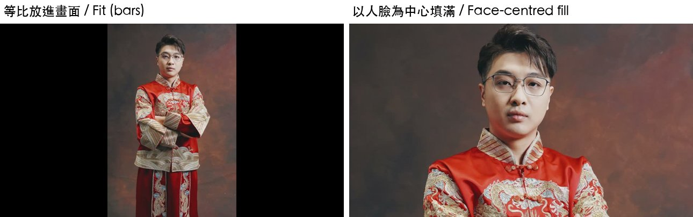

# 第 4 章　時間軸與片段：軌道、位置、縮放、裁切、疊圖

> 英文版：[docs/en/04-clips.md](../en/04-clips.md)
> 範例：[examples/04_clip_properties.py](../../examples/04_clip_properties.py)（19 條 PASS）

驗證環境：macOS 27.0.1／Resolve Studio 21.1.0.14／2026-10-10。時間軸 1920×1080。量測方法：素材是黑底中央一個 120 px 白色方塊，輸出後找白色區域的邊界。

### 4.1 加軌道

- 結論：`tl.AddTrack("video")` 加一條影像軌，`tl.GetTrackCount("video")` 讀數量。`AppendToTimeline` 的 `trackIndex` 指到不存在的軌道會失敗，所以先加軌。
- 驗證：實測通過。

### 4.2 位移 Pan／Tilt 的單位

- 結論：
  - 橫幅、剛好填滿畫面的素材：`Pan=100` 往右 **100 px**；`Tilt=100` 往**上** 100 px（正值向上）。
  - 直幅素材（1080×1920 放進 16:9 時間軸，等比縮成 607.5 px 寬）：`Pan=100` 只移動 **32 px**。Pan 會乘上「素材在畫面中的寬度 ÷ 1920」。
  - Pan 不會被 Zoom 放大（Zoom 0.5 時 Pan 400 仍移動 400 px）。
- 驗證：實測通過（橫幅 +100／+100；直幅 +32，理論值 31.6）。
- 做法：想讓直幅照片移動 N 個畫面像素，設 `Pan = N * 1920 / 素材顯示寬度`。

```python
fit_w = src_w * min(1920 / src_w, 1080 / src_h)   # 素材在畫面中的寬度
item.SetProperties({"Pan": n_px * 1920 / fit_w})
```

- 不要：把 Pan 當成畫面像素直接用在直幅素材上，會移得太少。

### 4.3 縮放 ZoomX／ZoomY

- 結論：以畫面中心為基準等比縮放，`2.0` 是兩倍。
- 驗證：實測通過（方塊寬度變 2.02 倍）。

### 4.4 裁切 CropLeft／Right／Top／Bottom 的單位

- 結論：單位是「素材**在畫面中**（等比縮進畫面後、套用 Zoom 前）的像素」，從**素材自己的邊**算起，不是從畫面邊算。裁切**不會移動**畫面，被裁掉的地方變透明。
- 驗證：實測通過。
  - 橫幅（填滿 1920）：`CropLeft=940` 時，畫面 x < 940 被裁掉。
  - 直幅（顯示在 x = 656～1263）：`CropLeft=300` 時，裁切線在 x = 656 + 300 = **956**；`CropLeft=400` 時方塊（x 926～992）完全消失。
- 做法：要裁到畫面 x = X 的位置，設 `CropLeft = X - 素材左邊緣位置`。
- 不要：拿素材原始解析度的像素算裁切值（直幅 1080 寬的素材，原始像素和畫面像素差 1.78 倍）。

> 人類補充：作者先前在另一組 3240×2160 素材上記成「縮放前的畫面像素」，就是這裡說的「等比縮進畫面後、Zoom 前」。

### 4.5 透明度 Opacity

- 結論：`Opacity` 0～100。上層 50 時，結果是上下兩層的平均。
- 驗證：實測通過（藍 (32,96,192) 50% 疊在灰 (128,128,128) 上，得到 (77,110,162)，理論值 (80,112,160)）。

### 4.6 疊圖模式 CompositeMode

- 結論：`SetProperties({"CompositeMode": r.COMPOSITE_SCREEN})`，常數在 `resolve` 物件上（`COMPOSITE_NORMAL`、`COMPOSITE_ADD`、`COMPOSITE_SCREEN`、`COMPOSITE_MULTIPLY`……，完整清單看 .pyi）。漏光、光斑素材疊在上層用 Screen。
- 驗證：實測通過（灰 128 Screen 灰 128 = 192，理論值 1−(1−0.5)² = 0.75 → 191）。
- 不要：傳字串 `"Screen"`，要傳常數。若計畫檔（JSON）裡存字串，讀進來時用 `getattr(r, "COMPOSITE_" + name.upper())` 轉。

### 4.7 旋轉 RotationAngle

- 結論：單位是度，可以和 Zoom、Pan 一起設。
- 驗證：實測通過（90 度＋Zoom 0.5＋Pan 400）。

### 4.8 同一軌重疊放置：先放的贏

- 結論：在同一軌已有片段的範圍再 `AppendToTimeline`，**回傳成功但不會覆蓋**，畫面上還是先放的那段。
- 驗證：整理自 samuelgursky，本 repo 已實測（第二次放置回傳非空，但該範圍軌道上只有第一個片段）。
- 不要：拿 `AppendToTimeline` 的回傳值判斷有沒有放上去；放之前自己檢查範圍是否空著，或放到新軌道。

### 4.9 片段不能移動、修剪

- 結論：`TimelineItem` 只有讀取位置的函式（`GetStart`、`GetDuration`、`GetLeftOffset`……），**沒有**設定位置、長度、切斷的函式。
- 驗證：整理自 samuelgursky，本 repo 已實測（.pyi 中沒有對應 setter）。
- 做法：重建一條新時間軸；或匯出 .drt 改檔再匯入，見第 9 章。

### 4.10 直幅照片在 16:9 填滿畫面、臉放在固定位置

- 結論：照 4.2、4.4 的單位，可以算出「把直幅照片放大到填滿寬度、臉放在畫面上方約 40% 處」的 Zoom／Pan／Tilt；再把位移限制在不露出黑邊的範圍內。
- 驗證：實測通過（[examples/17_photo_demo.py](../../examples/17_photo_demo.py) 的 `fill_on_face()`，作者本人照片；輸出兩側沒有黑邊、臉位置正確）。
- 做法：

```python
fit = min(1920 / src_w, 1080 / src_h)
fit_w, fit_h = src_w * fit, src_h * fit
zoom = 1920 / fit_w
cx, cy = face_center                                # 0..1，從照片左上算
dx = -(cx - 0.5) * fit_w * zoom                     # 畫面像素，往右為正
dy = (cy - 0.5) * fit_h * zoom - (0.40 - 0.5) * 1080   # 往上為正
dx = max(-(fit_w * zoom - 1920) / 2, min((fit_w * zoom - 1920) / 2, dx))
dy = max(-(fit_h * zoom - 1080) / 2, min((fit_h * zoom - 1080) / 2, dy))
item.SetProperties({"ZoomX": zoom, "ZoomY": zoom, "Pan": dx * 1920 / fit_w, "Tilt": dy})
```

- 臉的位置：macOS 可用 Vision 的人臉偵測取得（本 repo 作者用 `VNDetectFaceRectanglesRequest`）。
- 不要：忘了限制位移。臉靠近照片邊緣時，只照臉的位置移動會露出黑邊（本 repo 第一次就在一張臉偏左的照片上露出左側黑邊）。



