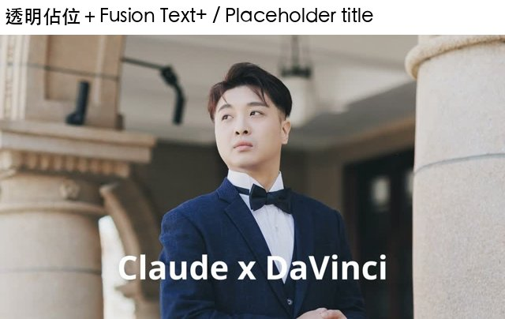

# 第 6 章　字卡（Text+ 與 Fusion 字卡模板）

> 英文版：[docs/en/06-titles.md](../en/06-titles.md)
> 範例：[examples/06_titles.py](../../examples/06_titles.py)

驗證環境：macOS 27.0.1／Resolve Studio 21.1.0.14／2026-10-10。

### 6.1 `InsertFusionTitleIntoTimeline` 一律插在 V1、而且是「插入」

- 結論：`tl.InsertFusionTitleIntoTimeline("Text+")` 把字卡放在**播放頭位置的 V1**，並且是**插入編輯**：把 V1 上原本的片段切開，後半段整段往後推（時間軸變長）。不是疊在上層、也不是覆蓋。
- 驗證：實測通過。150 格的片段，播放頭在第 30 格插入後，V1 變成「片段 0–30｜Text+ 30–180｜片段 180–300」；V2 是空的。
- 預設長度：150 格（30fps 下 5 秒）。
- 不要：
  - 以為鎖住 V1 就會改放到 V2：**鎖住 V1 時回傳 `None`**，什麼都沒放。
  - 以為停用 V1 就會改放：**停用 V1 時照樣放在 V1**。
  - 沒有任何 API 可以指定目標軌（整理自 samuelgursky：Source／Auto Track Selector 沒有對應 API）。
- 確認：`item.GetTrackTypeAndIndex()` 回傳 `['video', 1]`。

> 人類補充：作者一開始以為字卡會「蓋掉」底下的照片，實測才發現是把照片切開往後推。卡點影片的切點都是算好的，被往後推等於整條時間軸都對不上拍子，所以不能直接在成品時間軸上插字卡。

### 6.2 改字：透過字卡的 Fusion comp

- 結論：Fusion 字卡的內容在它的 Fusion comp 裡，用 `GetToolList(False, "TextPlus")` 找到文字工具，改 `StyledText`（內容）與 `Size`（大小）。
- 驗證：實測通過（設成 `TAKE ME` 後讀回一致，輸出看得到）。
- 做法：

```python
comp = title_item.GetFusionCompByIndex(1)
for t in comp.GetToolList(False, "TextPlus").values():
    t.SetInput("StyledText", "TAKE ME")
    t.SetInput("Size", 0.2)
```

- 注意：有些模板裡有不只一個 TextPlus（例如 Background Reveal Lower Third 有兩個，其中一個當遮罩用），上面的寫法會全部改成同樣的字。
- 注意：`Slide In` 模板預設文字是**空的**，不設文字輸出就什麼都沒有。

### 6.3 把字卡放到任意軌與時間：做法 A，巢狀時間軸

- 結論：先在一條**只有字卡的小時間軸**插入並改好字，這條時間軸在媒體池裡就是一個片段，再用 `AppendToTimeline` 放到主時間軸的 V2（或任何軌）、任何位置、任何長度。
- 驗證：整理自 samuelgursky（他們的建議做法），本 repo 已實測：字卡準確出現在 V2 的 1.0–2.0 秒，其他時間透明，底下的灰色畫面完整保留。
- 做法：

```python
sub = mp.CreateEmptyTimeline("title_TAKE_ME")
p.SetCurrentTimeline(sub)
t = sub.InsertFusionTitleIntoTimeline("Text+")
# ……用 6.2 改字……
sub_item = next(c for c in mp.GetRootFolder().GetClipList() if c.GetName() == "title_TAKE_ME")
p.SetCurrentTimeline(main)
mp.AppendToTimeline([{"mediaPoolItem": sub_item, "startFrame": 0, "endFrame": 30,
                      "trackIndex": 2, "recordFrame": main.GetStartFrame() + 30, "mediaType": 1}])
```

- 使用者怎麼改字：在主時間軸雙擊那段，進入小時間軸，選字卡在檢查器裡改。
- 取捨：每個字卡都多一條時間軸，專案會變雜，建議放進專用資料夾。

### 6.4 把字卡放到任意軌與時間：做法 B，透明佔位片段＋Fusion 文字

- 結論：在目標軌放一段**全透明的影片**（ProRes 4444 含 alpha），在它的 Fusion comp 裡加 TextPlus，用 Merge 疊在 MediaIn 上。位置、長度就是佔位片段的位置、長度。
- 驗證：實測通過（本 repo 想出的做法）：文字準確出現在 V2 的 2.5–3.5 秒，前後透明。
- 做法：

```bash
ffmpeg -f lavfi -i "color=c=black@0.0:s=1920x1080:r=30:d=10,format=yuva444p10le" \
       -c:v prores_ks -profile:v 4 -pix_fmt yuva444p10le transparent_10s.mov
```

```python
ph = append(mp, tl, transparent_clip, 75, 30, track=2)
comp = ph.AddFusionComp()
mi, mo = comp.FindTool("MediaIn1"), comp.FindTool("MediaOut1")
tx = comp.AddTool("TextPlus", -32768, -32768)
tx.SetInput("StyledText", "LOVE"); tx.SetInput("Size", 0.2)
mg = comp.AddTool("Merge", -32768, -32768)
mg.ConnectInput("Background", mi); mg.ConnectInput("Foreground", tx)
mo.ConnectInput("Input", mg)
```

- 使用者怎麼改字：點那段 → Fusion 頁 → 選 Text 節點改。比做法 A 多一步，但時間軸不會多出來。
- 延伸：同一個 comp 裡可以再加動畫、光暈等 Fusion 工具（第 10 章）。




| | 做法 A 巢狀時間軸 | 做法 B 透明佔位 |
|---|---|---|
| 使用者改字 | 雙擊進去，在檢查器改（直覺） | 進 Fusion 頁改 |
| 專案雜亂度 | 每個字卡一條時間軸 | 不增加時間軸 |
| 能用內建字卡模板 | 可以 | 只能自己組 Fusion 節點 |

### 6.5 可用的字卡模板名稱

- 結論：`InsertFusionTitleIntoTimeline(名稱)` 實測可用的 14 個名稱，輸出都看得到字：

`Text+`、`MultiText`、`Text`、`Scroll`、`Background Reveal`、`Background Reveal Lower Third`、`Call Out`、`Center Reveal`、`Clean and Simple`、`Dark Box Text`、`Digital Glitch`、`Drop In`、`Fade On`、`Slide In`

- 叫不到（回傳 `None`）：`Lower 3rd`、`Simple Underline`、`Draw On 1 Line`。名稱同樣分大小寫，猜不到時到 Resolve 的特效庫看確切名稱。
- 驗證：實測通過（每個模板改字成 `SAMPLE` 後，在 1.0／2.5／4.0 秒至少一格出現文字）。
- 注意：Background Reveal Lower Third 的字是深灰色，放在黑底上很暗（亮度約 59/255），不是沒出現。
