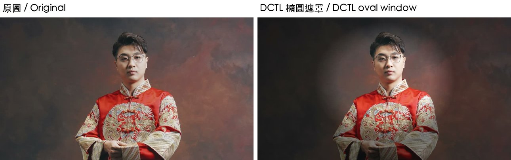

# 第 14 章　DCTL：自己寫遮罩與選色

> 英文版：[docs/en/14-dctl.md](../en/14-dctl.md)
> 範例：[examples/dctl/](../../examples/dctl/)、[examples/13_color.py](../../examples/13_color.py)

驗證環境：macOS 27.0.1／Resolve Studio 21.1.0.14／2026-10-10。

DCTL 是 Resolve 的自訂調色小程式（類 C 語法），每個像素跑一次。因為拿得到像素座標和顏色，可以自己做出「遮罩」（依位置）和「選色」（依顏色）的效果，而且全程用程式完成，不用點畫面。

### 14.1 驗證語法：`ValidateDCTL`

- 結論：21.1 新增 `r.ValidateDCTL(原始碼字串)`，成功回傳 `None`，失敗回傳錯誤訊息字串。
- 驗證：實測通過（兩支範例 DCTL 都回傳 `None`）。
- 注意：samuelgursky 記錄它對原始碼排版敏感（未實測細節）。

### 14.2 套用：當成 LUT 用

- 結論：把 `.dctl` 放進主 LUT 資料夾（13.3），`RefreshLUTList()` 後用 `SetLUT(1, "子資料夾/x.dctl")` 套用。
- 驗證：實測通過。
- 取捨：以 LUT 方式套用時，Resolve **不會顯示 DCTL 的參數滑桿**（`DEFINE_UI_PARAMS` 的預設值就是實際使用的值）。要改參數就改檔案；要讓使用者用滑桿調，請他用 Resolve FX「DCTL」特效載入同一個檔案。

### 14.3 橢圓遮罩：裡面提亮、外面壓暗

- 結論：用像素座標算到橢圓中心的距離，做出柔邊遮罩，裡外套不同增益。效果類似 Power Window 加暗角。
- 驗證：實測通過（純灰畫面上，中心 143、角落 70）。
- 原始碼：[examples/dctl/oval_window.dctl](../../examples/dctl/oval_window.dctl)。重點：

```c
float u = (float)p_X / (float)p_Width;      // 0..1，左到右
float v = (float)p_Y / (float)p_Height;     // 0..1，上到下
float d = _sqrtf(((u - cx) / rx) * ((u - cx) / rx) + ((v - cy) / ry) * ((v - cy) / ry));
float m = 1.0f - _saturatef((d - (1.0f - soft)) / _fmaxf(soft, 0.0001f));   // 1 = 裡面
float g = outGain + (inGain - outGain) * m;
return make_float3(p_R * g, p_G * g, p_B * g);
```

- 限制：位置固定，不會追蹤移動的人；要追蹤需在畫面上用 Power Window＋追蹤器（第 15 章）。




### 14.4 選色：只保留膚色，其他降飽和

- 結論：把 RGB 換算成色相與飽和度，色相接近目標（膚色約 0.06）且飽和度夠的像素保留顏色，其他像素往灰階拉。效果類似限定器（Qualifier）。
- 驗證：實測通過（彩色測試畫面套用後差異 81.5；作者在婚紗照上目視確認：紅色禮服變淡、臉的膚色保留）。
- 原始碼：[examples/dctl/skin_qualifier.dctl](../../examples/dctl/skin_qualifier.dctl)。

### 14.5 DCTL 寫法提醒

- 進入點：`__DEVICE__ float3 transform(int p_Width, int p_Height, int p_X, int p_Y, float p_R, float p_G, float p_B)`。
- 參數：`DEFINE_UI_PARAMS(變數, 顯示名稱, DCTLUI_SLIDER_FLOAT, 預設, 最小, 最大, 間距)`。
- 數學函式用底線版本：`_sqrtf`、`_fmaxf`、`_fminf`、`_saturatef`、`_fabs`、`_fmod`。
- 官方語法參考：官方 MCP 的 `get_scripting_docs` 文件「DCTLReadme.txt」；samuelgursky 的 [dctl-notes.md](https://github.com/samuelgursky/davinci-resolve-mcp/blob/main/docs/notes/dctl-notes.md) 也整理了轉場用 DCTL 的進入點等（未實測）。
