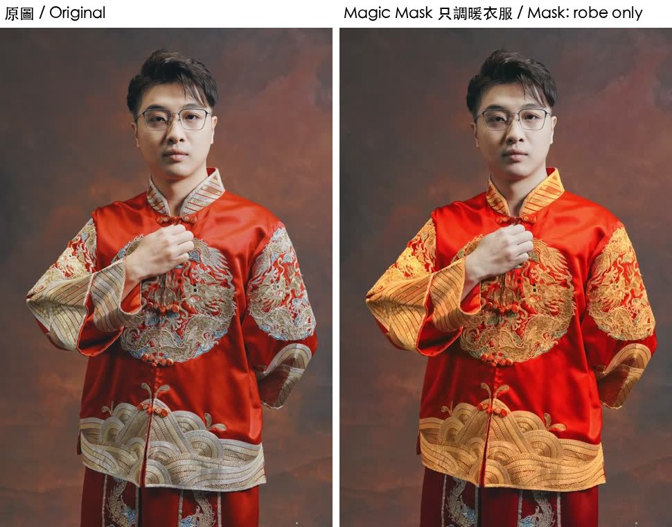

# 第 19 章　「API 做不到」清單重測：21.1 可以做到的

> 英文版：[docs/en/19-beyond-limits.md](../en/19-beyond-limits.md)
> 範例：[examples/19_beyond.py](../../examples/19_beyond.py)、[examples/19b_more.py](../../examples/19b_more.py)；字幕檢查：[examples/tools/caption_qa.py](../../examples/tools/caption_qa.py)（19.15）

驗證環境：macOS 27.0.1／Resolve Studio 21.1.0.14／2026-10-10。

samuelgursky 的 [api-limitations.md](https://github.com/samuelgursky/davinci-resolve-mcp/blob/main/docs/reference/api-limitations.md) 列了 99 條 API 做不到的事，很多是在 19.x／21.0 測的。本章挑其中幾條在 21.1 重測，並記錄繞路做法。之前章節已經處理過的：變速曲線（8.2）、移動與修剪（9.1）、檢查器關鍵影格（7.2）、可拖曳遮罩（15.1）。

### 19.1 音量、左右聲道、音高：21.1 已有屬性

- 原說法（samuelgursky）：沒有 API 能設定片段或軌道的音量、聲道、EQ。
- 結論：21.1 的 `TimelineItemProperties` 有 `AudioVolumeEnabled`／`AudioVolume`（-100～30 dB）、`AudioPanEnabled`／`AudioPan`（-100～100）、`AudioPitchEnabled`／`AudioPitchSemiTones`，用 `SetProperties` 設定，輸出有效。CHANGELOG 21.1：「Get/Set Property includes native audio properties」。
- 驗證：實測通過——
  - `AudioVolume = -12`：輸出從 -21.1 dB 變 -33.1 dB，剛好少 12.0 dB。
  - `AudioPitchSemiTones = 12`：440 Hz 變 880 Hz（零交越次數 879→1760／秒）。
  - `AudioPan = -100`：左 -15.1 dB、右 -27.1 dB，差 12 dB，**右聲道沒有完全靜音**（測試音是單聲道素材）。
- 做法：

```python
audio_item.SetProperties({"AudioVolumeEnabled": True, "AudioVolume": -12.0})
audio_item.SetProperties({"AudioPitchEnabled": True, "AudioPitchSemiTones": 12.0})
```

- 仍做不到：EQ、Fairlight 特效、音量自動化（未測）。

### 19.2 切斷片段（剃刀）：改 .drt

- 原說法：沒有剃刀、切割片段的 API。
- 結論：匯出 .drt，在 `SeqContainer/*.xml` 把該片段的 `<Element>…<Sm2TiVideoClip>…</Element>` 複製一份，前段改 `Duration`，後段改 `Start`、`Duration`、`In`，**並把複製段裡所有 `DbId` 換成新的 UUID**，再匯入。
- 驗證：實測通過——90 格的片段切成 (0–45，來源 30) 與 (45–90，來源 75)，輸出與原本逐格相同；切開後兩段可分別設定屬性。
- 做法：見範例 19.2 段。關鍵：

```python
second = re.sub(r'DbId="[0-9a-f-]+"', lambda _: f'DbId="{uuid.uuid4()}"', element)
second = second.replace(f"<Start>{s0}</Start>", f"<Start>{s0 + cut}</Start>", 1) \
               .replace(f"<Duration>{d}</Duration>", f"<Duration>{d - cut}</Duration>", 1) \
               .replace(f"<In>{src_in}</In>", f"<In>{src_in + cut}</In>", 1)
```

- 不要：沿用原本的 `DbId`。（未測重複 ID 的後果，但每個物件都有唯一 ID，複製時一律換新。）

### 19.3 讀回轉場：從 .drt 讀

- 原說法：21.1 可以建立轉場，但讀不回來（5.7）。
- 結論：匯出 .drt 後，每個轉場是一個 `<Sm2TiTransition>`，有 `<PrettyType>`（種類）、`<Start>`、`<Duration>`、`<AlignmentType>`。Fusion 轉場的 `PrettyType` 一律是「Fusion Transition」，真正的模板名稱寫在十六進位的 `<FieldsBlob>` 裡，形如 `Templates/Edit/Transitions/Brightness Flash`。
- 驗證：實測通過——讀回 Cross Dissolve（20 格）與 Brightness Flash（14 格），與設定一致。`AlignmentType`：置中為 `2`、靠右為 `1`。
- 做法：

```python
blob = bytes.fromhex(fields_blob_hex)
name = re.search(rb"Templates/Edit/Transitions/([ -~]+?)(?:[^ -~]|$)", blob).group(1).decode()
```

### 19.4 字幕：匯入 .srt

- 原說法：不能用 API 設定字幕文字與時間。
- 結論：寫一份 .srt → `MediaPool.ImportMedia([srt])` → `tl.AddTrack("subtitle")` → `AppendToTimeline` 放到字幕軌，每一句都成為字幕軌上的一個項目，文字與時間照 .srt。要改字：改 .srt、在新時間軸重新放。
- 驗證：實測通過（英文與中文各一句，時間 0.5–2.0 秒、2.5–4.0 秒，讀回完全正確）。
- 雷：**字幕的 `recordFrame` 會被忽略，自動接在時間軸現有內容的最後面**。先放了 5 秒影片再放字幕，字幕就從第 5 秒開始。解法：**先放字幕、再放影片**。
- 仍做不到：直接改字幕軌上某一句的文字、字幕樣式（samuelgursky 改資料庫可以，需關閉 Resolve，未測）。
- 放上去之前先跑 19.15 的 `caption_qa.py` 檢查 .srt。

### 19.5 字幕燒進畫面

- 原說法：`SetRenderSettings` 的 `ExportSubtitle`／`SubtitleFormat` 在 19.x 沒有效果。
- 結論：21.1 設 `{"ExportSubtitle": True, "SubtitleFormat": "BurnIn"}` 後輸出，字幕會燒進畫面。
- 驗證：實測通過（1.0 秒與 3.0 秒畫面下方出現白字，兩句之間的 2.2 秒沒有）。

### 19.6 只能在畫面上點的功能：Magic Mask

- 原說法：`CreateMagicMask` 需要操作者點選，無法自動化（本 repo 呼叫也回傳 `False`，15.3）。
- 結論：用 CGEvent 模擬滑鼠（1.11）就能完成：調色頁 → 「AI 神奇遮罩」面板 → 在檢視器中點一下要選的物件 → 按追蹤（雙向）→ 完成後用程式輸出驗證。
- 驗證：實測通過（2026-10-10，作者本人照片）。片段先用 API 設 CDL 調暖；點衣服建立遮罩並追蹤後輸出，與原圖比較：
  - 衣服：(126, 90, 79) → (173, 90, 49)，變暖
  - 臉：(141, 114, 100) → (140, 114, 100)，不變
  - 背景：(69, 60, 58) → (68, 59, 58)，不變
- 注意：點衣服只會選到衣服；要選整個人，改用遮罩的人物模式或多點幾個點（未測）。追蹤需要幾秒到十幾秒，完成後面板的「Overall Track」出現綠色勾勾。
- 面板位置（簡體中文介面、1920×1080）：調色頁下方工具列的遮罩圖示；追蹤按鈕在面板上方的播放鍵列。座標會因介面配置不同而變，每次都先截圖找。



### 19.7 聲道對應：單聲道／立體聲轉換

- 原說法：不能用 API 轉換片段的聲道格式。
- 結論：21.1 新增 `MediaPoolItem.SetAudioMapping(json)` 與 `TimelineItem.SetSourceAudioChannelMapping(json)`，格式見官方 README「Audio Mapping」。只處理 `track_mapping`；`channel_idx` 的長度要符合 `type`（Mono=1、Stereo=2）。
- 驗證：實測通過——左 440 Hz／右 880 Hz 的測試音，設 `channel_idx: [1, 1]` 後輸出的右聲道變成 440 Hz（零交越 1759→880）。
- 做法：

```python
item.SetSourceAudioChannelMapping('{"track_mapping": {"1": {"channel_idx": [1, 1], "mute": false, "type": "Stereo"}}}')
```

### 19.8 代理檔：自己做、再連結

- 原說法：不能用 API 產生代理檔（Proxy／Optimized Media）。
- 結論：產生不行，但 `MediaPoolItem.LinkProxyMedia(path)` 可以連結。用 ffmpeg 自己做一份小檔（例如 960 寬 ProRes Proxy）再連結，效果相同。
- 驗證：實測通過（連結後 `GetClipProperty("Proxy")` 回傳 `960x640`、`Proxy Media Path` 為該檔）。
- 做法：

```bash
ffmpeg -i clip.mp4 -vf scale=960:-2 -c:v prores_ks -profile:v 0 clip_proxy.mov
```

```python
item.LinkProxyMedia("/path/clip_proxy.mov")   # 取消：item.UnlinkProxyMedia()
```

### 19.9 媒體夾「改名」

- 原說法：Folder 沒有改名函式。
- 結論：用三步模擬：`AddSubFolder(父, 新名)` → `MoveClips(舊.GetClipList(), 新)` → `DeleteFolders([舊])`。
- 驗證：實測通過（舊名消失、新名資料夾內素材完整）。
- 注意：舊資料夾若有子資料夾，要用 `MoveFolders` 一起搬（未測）。

### 19.10 Render in Place：只輸出某段、再放回

- 原說法：沒有「就地算圖」的 API。
- 結論：`SetRenderSettings` 設 `SelectAllFrames: False`、`MarkIn`／`MarkOut`（**時間軸絕對格數**）只輸出該片段的範圍，匯入後放回同位置的上層軌（或取代原片段）。
- 驗證：實測通過——含 Resolve FX Glow 的 2 秒片段，烤成 60 格的 ProRes 檔，與即時效果逐格差異 0.89（近乎相同）。
- 用途：很重的 Fusion 特效先烤成檔案，後續播放、輸出都變快。

### 19.11 剪輯模式：插入、覆蓋、取代、適配填滿

| 模式 | 做法 | 驗證 |
|---|---|---|
| 插入（Insert） | 另建一條只有新片段的小時間軸，兩份 .drt 合併：新片段的元素換新 DbId、`Start` 設為插入點，目標時間軸中插入點之後的所有 `Start` 加上新片段長度 | 實測通過：A 0–60｜X 60–90｜B 被推到 90–150 |
| 覆蓋（Overwrite） | 同插入，但不後推，改成修剪被蓋住的片段 `Duration`／`In` | 原理同 19.2、19.11 插入，未單獨測 |
| 取代（Replace） | `MediaPoolItem.ReplaceClip(新檔路徑)`：換掉素材，時間軸上的剪接點不變（**所有用到該素材的地方都會換**） | 實測通過：畫面改變、長度仍 60 格 |
| 適配填滿（Fit to Fill） | 先放「空格長度」的片段，再 `SetSpeed({"Percentage": 來源格數 / 空格格數 * 100})` | 實測通過：120 格素材塞進 60 格，最後一格是來源第 118 格 |

### 19.12 智慧媒體夾：用滑鼠建立

- 原說法：沒有建立 Smart Bin／Power Bin 的 API。
- 結論：用 CGEvent 點媒體池左下「智能媒體夾」旁的「＋」→ 名稱欄 Cmd+A 後輸入名稱 → 規則（媒體池屬性／文件名稱／包含）的值欄輸入條件 → 點「創建」。**文字輸入用 AppleScript 的 `keystroke` 就可以**，只有點擊需要 CGEvent。
- 驗證：實測通過（2026-10-10）：建立「Claude clips」、規則「文件名稱包含 clip_」，點開後只列出符合的素材。
- 限制：建立後 API 讀不到智慧媒體夾（不在 `GetSubFolderList()` 裡），只能用截圖確認。

### 19.13 AI 音頻助手（自動混音）：能觸發，純音樂不適用

- 原說法：AI Audio Assistant 沒有腳本方法。
- 結論：它在選單「時間線 → AI 工具 → 音頻助手…」。**選單項目可以直接用 AppleScript 點**（不用找座標）：

```bash
osascript -e 'tell application "System Events" to tell process "Resolve"
click menu item "音频助手…" of menu 1 of menu item "AI工具" of menu "时间线" of menu bar item "时间线" of menu bar 1
end tell'
```

  （選單文字依介面語言；上例為簡體中文介面。）接著在對話框選交付標準、點「自動混音」。
- 驗證：觸發實測通過——它把軌道音量拉到 -15、加上多頻段壓縮器與限制器，響度表切成 YouTube（LUFS）。
- **但效果要看素材**：純音樂（Mixkit 曲目）混音前 -20.4 LUFS，混音後 **-28.8 LUFS**，離 YouTube 常見的 -14 更遠；測試音也一樣變小聲。推測它是為「人聲＋配樂」設計，會把音樂壓低當背景。純音樂的卡點影片不建議使用；有人聲的素材未測。
- 量響度：`ffmpeg -i out.mp4 -vn -af ebur128=peak=true -f null -`。

### 19.14 總結：24 條「API 沒有的功能」

| 狀態 | 數量 | 項目 |
|---|---|---|
| 解決或繞過 | 14 | 字卡指定軌、移動修剪、剃刀、變速曲線、建立與讀回轉場、字幕文字與時間、聲道格式、代理檔、Render in Place、智慧媒體夾、媒體夾改名、AI 音頻助手（可觸發）、剪輯模式（插入／取代／適配填滿）、用名稱找時間軸 |
| 部分解決 | 4 | 調色節點與調色輪數值（用 DRX／DCTL／滑鼠代替）、音訊 EQ 與自動化（音量聲道音高已可）、語音辨識引擎選擇（.srt 匯入已可）、覆蓋剪輯（原理同插入，未單獨測） |
| 沒做 | 6 | 雲端專案（需帳號）、字幕樣式（需關 Resolve 改資料庫）、讀回 CDL、讀回節點開關、讀回關鍵影格曲線（二進位資料）、SetHighPriority（不可逆） |
| 未測 | 1 | CreateTimelineFromClips 的行為差異 |

> 人類補充：只要介面上有按鈕，用滑鼠自動化理論上都做得到；但慢、而且介面改版座標就會變，所以只當最後手段。能用 API 或改檔案做到的，一律優先。


### 19.15 字幕檢查：讀速、時間、抽聽

- 結論：.srt 匯入（19.4）不會檢查內容，時間寫錯照樣放上去。`examples/tools/caption_qa.py` 在放上時間軸或燒進畫面前檢查：每一句能解析、沒有結束早於開始、沒有重疊或順序顛倒、最後一句沒超出影片長度、句子不會太短、中文讀速不會太快。`--asr N` 再平均抽 N 句，用 whisper-cli 聽該句時間範圍（前後各多 0.25 秒）的聲音，算「字幕的字有多少比例依序出現在聽到的內容裡」。
- 驗證：檢查項目整理自 Hao0321；程式為本 repo 重寫，本 repo 已實測｜macOS 27.0.1／whisper.cpp 1.9.1（large-v3-turbo）／2026-10-23。
  - 故意寫壞的 .srt（讀速 16 字／秒、與前句重疊、結束早於開始、0.3 秒短句、超出 12 秒影片、時間碼打錯）：每一項都被抓到，exit code 1。正常的 .srt 全 PASS。
  - 第 22 章跳剪後重新對時的 .srt，配跳剪輸出：5 句抽聽全部 1.00。
  - **忘了重新對時**（原本的 .srt 直接配跳剪輸出）：最後兩句超出影片長度（17.56、20.95 秒 > 15.45 秒），抽聽 0.00～0.77，FAIL。
  - 字幕文字整體錯一句（時間對、字是下一句的）：抽聽 0.00～0.10，FAIL。
  - 時間與文字都正確的 15 句：0.62～1.00。
- 做法：

```bash
python3 examples/tools/caption_qa.py captions.srt --media out.mp4            # 不用模型，瞬間完成
python3 examples/tools/caption_qa.py captions.srt --media out.mp4 --asr 8    # 抽 8 句聽，每句約 1.5 秒
```

  whisper-cli 路徑與模型寫在檔案開頭（`WHISPER`、`MODEL`），換機器要改。音訊會先轉成 16 kHz 單聲道 wav 再丟給它。
- 門檻：

| 項目 | 門檻 | 來源 |
|---|---|---|
| 中文讀速（不算標點、空白） | > 5 字／秒 WARN、> 7 字／秒 FAIL | 整理自 Hao0321 的起始值，**未驗證**（本 repo 的測試句是 3.6～4.1 字／秒） |
| 最短一句 | < 0.7 秒 WARN | 本 repo 選的，**未驗證** |
| 超出影片 | 結束時間 > 片長 + 0.04 秒 FAIL | 約一格 |
| 抽聽 | 聽到的比例 < 0.5 FAIL | Hao0321 的起始值；本 repo 實測：正確的句子最低 0.62，整句錯的最高 0.10 |

  讀速只套用在大部分是中日韓文字的句子，英文句不判（英文的合理讀速另計，未測）。
- 雷：
  - whisper 的 `-l zh` 預設吐**簡體字**，「這裡」變「这里」，比對直接掉分。加 `--prompt "以下是繁體中文。"`（工具預設就帶）後大多是繁體，但實測 15 句裡仍有 1 句吐簡體，分數掉到 0.62。門檻 0.5 擋得住整句錯的，**擋不住只偏了半句的**（忘了對時的前兩句是 0.77、0.60，照樣過）。所以抽聽 FAIL 一定有問題，PASS 不保證時間精準。
  - **只用在說話的字幕**。歌詞對字不要用 Whisper：它的字級時間整體早 0.8～1 秒、快歌完全對不上（16.7）。
- 不要：把抽聽當成自動上字幕。它只驗證「這句話是不是在這段時間說的」。

> 人類補充：讀速的數字是起始值，最準的方法是自己的觀眾看幾支之後再調。工具最有價值的地方其實是抓「忘了對時」「整份字幕錯一句」這種一看就知道、但沒人去看的錯。
