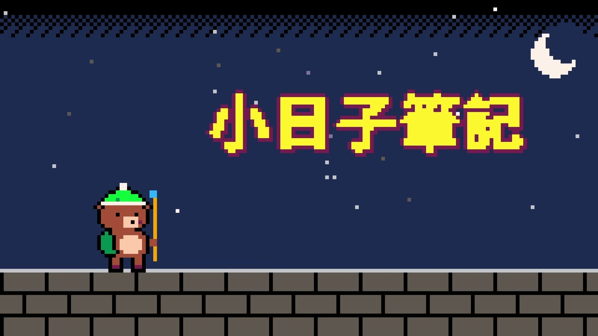
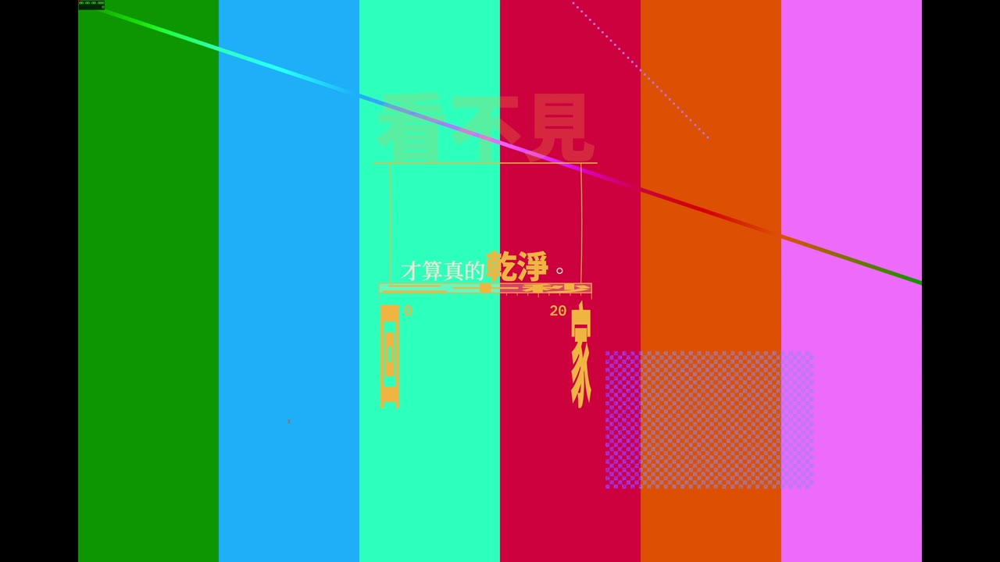

# 第 20 章　用程式產生片頭，再接進 Resolve

> 英文版：[docs/en/20-intro-generator.md](../en/20-intro-generator.md)
> 範例：[examples/20_intro_generator/](../../examples/20_intro_generator/)（片頭產生器）、[examples/20_intro_import.py](../../examples/20_intro_import.py)（接進 Resolve 的實測）
> 提示詞：[prompts/intro-templates.zh-TW.md](../../prompts/intro-templates.zh-TW.md)（本 repo 改寫的 11 個片頭模板）、[prompts/third-party/opus55-long-prompts.zh-TW.md](../../prompts/third-party/opus55-long-prompts.zh-TW.md)（29 則公開長提示詞中譯，版權屬原作者）

驗證環境：macOS 27.0.1／Resolve Studio 21.1.0.14／Remotion 4.0.534／Node 26.11／2026-10-11。

前面各章都在 Resolve 裡面做事。但「逐格自己畫」的動態設計（字一個個彈進來、沙子聚成名字、像素角色施法）用 Resolve API 做不到，用 Fusion 節點硬接也很痛苦。比較好的分工是：**片頭用程式算成影片，Resolve 只負責把它接上去**。本章的產生器用 [Remotion](https://www.remotion.dev/)（React 寫畫面、逐格輸出），再用 Python 腳本把成品放進 Resolve 時間軸，並逐項驗證。

### 20.1 產生器：一個種子決定一支片頭

- 結論：`examples/20_intro_generator` 有三個已實作的模板（11 像素風、8B 沙畫、6 字體即結構）。給一個整數種子，它用固定種子亂數抽出模板、配色、字型、轉場方向等，同一個種子永遠得到同一支片頭。抽到「不要搭在一起」的組合（例如深色底配細字重）會自動重抽，並在總表上標「有重抽」。
- 驗證：實測通過——種子 1～4 的定格總表與種子 7、11 的完整影片，在全新的資料夾從 `npm install` 開始重建，成功。速度（Apple Silicon）：8 張定格約 12 秒、6 秒的像素風片頭（60fps）約 10 秒。
- 做法：

```bash
cd examples/20_intro_generator
npm install
./fetch_fonts.sh                          # 從 google/fonts 下載 7 個 SIL OFL 字型（約 100 MB）
python3 -m venv .venv && .venv/bin/pip install -r requirements.txt   # numpy（音效）、pillow（總表）
node gen.mjs sheet 1 8                    # 種子 1～8 各算定格一張 → out/gen/sheet_1-8.png
node gen.mjs render 7 --fps 30            # 種子 7 的完整影片，30fps
node gen.mjs render 11 --fps 30 --alpha   # 透明背景版（只支援模板 6）
```

- 改文字：`src/content.ts`（頻道名、名字、副標）。模板 6 的四句話寫在 `src/TypeStructure.tsx`，因為每句的版面是個別調過的。
- 改隨機池或禁止組合：`src/pools.ts`。
- 不要：在 `src/content.ts` 放真實姓名、日期、地點之後把 repo 公開。

> 人類補充：先出一整排定格圖挑順眼的，再算完整影片，比每支都算完再挑省很多時間。同一批裡可能抽到一模一樣的組合（目前每個模板的選項不多），看到重複就換下一個種子。

### 20.2 提示詞模板：讓 AI 做新的片頭風格

- 結論：[prompts/intro-templates.zh-TW.md](../../prompts/intro-templates.zh-TW.md) 有一段「共通區塊」（規格、畫面要是時間的純函數、中文排版、配樂、禁用清單、自我檢查、交付）加上 11 個風格模板，每個模板列出要填的欄位和可以抽換的地方。本章產生器的三個模板就是照它做出來的。
- 驗證：模板 6、8B、11 實作並輸出成功（20.1）；其餘 8 個模板未實作。
- 做法：挑一個模板，填好欄位，把「共通區塊」接在後面，整段交給 Claude；要它照共通區塊的「自我檢查」先出分鏡表和關鍵靜態圖，再寫完整程式。做好的新模板加進 `src/pools.ts` 的 `TEMPLATES`，產生器就會一起抽。
- 參考：[prompts/third-party/](../../prompts/third-party/) 有 29 則公開長提示詞的中譯與寫法拆解，可以看別人怎麼寫規格。這些提示詞屬於原作者，見 20.8。

### 20.3 片頭接在時間軸開頭：影格率要先對齊

- 結論：產生器預設 60fps；本教學的專案是 30fps（第 2 章）。用 `--fps 30` 重新取樣後再匯入，匯入後是 30fps、180 格（6 秒），直接放在 V1 開頭，正片接在第 180 格。動畫是「秒數的函數」，換影格率不會改變時間與動作，只是取樣變少。
- 驗證：實測通過——
  - 匯入後 `FPS` = 30、`Frames` = 180。
  - 輸出影像長度剛好 11.000 秒（片頭 6 秒＋正片 5 秒）。
  - 輸出第 3.0 秒與片頭檔第 3.0 秒的平均差 0.18（0～255），第 8.0 秒與正片素材的差 0.0。
- 做法：

```python
intro = pool[INTRO]
append(mp, tl, intro, 0, 180)                   # V1 影像
append(mp, tl, intro, 0, 180, media_type=2)     # A1 聲音（音效）
append(mp, tl, programme, 180, 150)             # 正片接在後面
```

- 不要：沒有測過把 60fps 片頭直接放進 30fps 時間軸會怎樣；在產生器那端就輸出成時間軸的影格率，格數與秒數才能直接對上。

### 20.4 音效要輸出成立體聲，否則進 Resolve 會大 3 dB

- 結論：片頭音效如果是單聲道，Resolve 輸出立體聲時把同一個聲音放到左右兩邊，響度量起來會多約 3 LU。產生器原本出單聲道（-14.1 LUFS），進 Resolve 輸出後變 -11.1 LUFS；改成直接出立體聲（`-ac 2`）後，輸出是 -14.1 LUFS，和原檔一致。
- 驗證：實測通過（兩種都測過，數字如上）。
- 做法：`mux.py` 的 ffmpeg 參數加 `-ac 2`（產生器已改好）。響度用兩次 `loudnorm`（先量再調），目標 -14 LUFS、真峰值 -1 dBTP。
- 確認：輸出檔前 6 秒用 `ffmpeg -af ebur128` 量整合響度。

### 20.5 透明背景片頭疊在 V2

- 結論：`--alpha` 輸出 ProRes 4444（`yuva444p`，含 alpha）。放在 V2，底下 V1 的畫面只有片頭自己的像素會被蓋到，其他地方完全不變。9:16 的片頭放進 16:9 時間軸，會被縮成置中、寬 607.5 px 的直條（4.2）。
- 驗證：實測通過——同一條時間軸，V2 開與關各輸出一次，比較第 14.5 秒：直條外（左 0–640、右 1280–1920）平均色差 0.10／0.20（等於沒變）；直條內平均色差 19.90（片頭的字與線條確實疊上去）。
- 做法：

```python
tl.AddTrack("video")                            # 先加 V2，否則 trackIndex=2 放不上去（4.1）
append(mp, tl, pool[CLIP1], 0, 240)
append(mp, tl, pool[CLIP2], 240, 210)
append(mp, tl, pool[OVERLAY], 0, 450, track=2)
```

- 雷：沒先 `AddTrack` 時，`AppendToTimeline` 沒有回傳失敗，但輸出的第 14.5 秒完全看不到片頭（實測；沒有查它被放到哪裡）。
- 不要：用 H.264 輸出透明版。H.264 沒有 alpha，背景會變成黑色或白色。





### 20.6 重新算繪同檔名的片頭：先刪掉媒體池裡的舊片段

- 結論：改了產生器、用同一個檔名重新輸出後，媒體池裡的舊片段仍指向同一個路徑，但 Resolve 沿用舊的解碼資訊。本章實測時，片頭從單聲道改成立體聲（檔名不變），再輸出時間軸，工作在 6% 失敗（`JobStatus: Failed`）。刪掉用到它的時間軸和媒體池裡的舊片段、重新匯入後，輸出正常。
- 驗證：實測一次（上述情況）。沒有測「內容改了但格式完全一樣」時會不會也失敗。
- 做法：

```python
mp.DeleteTimelines([t for t in timelines if t.GetName().startswith("20_intro")])
mp.DeleteClips([c for c in mp.GetRootFolder().GetClipList() if c.GetClipProperty("File Path") in (INTRO, OVERLAY)])
pool = import_media(mp, [INTRO, OVERLAY, ...])
```

- 替代做法：每次重算都換檔名（例如加版本號），就不會撞到舊片段。

### 20.7 9:16 片頭的 IG Reel 安全區

- 結論：直式片頭的重要文字避開上方 250 px、下方 500 px、右側 200 px（1080×1920 座標）；部分手機會把左右各裁掉約 100 px，再往內縮。
- 驗證：部分實測——從 iPhone 上三支 IG Reel 的截圖量出介面遮住的範圍（上約 225、下約 495、右約 200），取整數並加一點餘量。**左右會不會被裁掉沒有確認**；產生器的 `calib` 組合可以輸出一支每 100 px 一條刻度的測試影片，發成 Reel 後在播放畫面截圖就能確認。
- 做法：

```bash
npx remotion render src/index.ts calib out/ig-safe-zone-test.mp4
```

- 人類補充：IG 發布前的編輯、分享畫面不會疊上播放時的按鈕和說明文字，那裡截圖量不準。要量就真的發出去（可關掉「同時分享到動態消息」），到個人頁 Reels 分頁全螢幕播放時截圖，截完再刪。

### 20.8 版權與字型

- 字型：產生器只用 Google Fonts 上 SIL OFL 授權的字型（思源黑體、思源宋體 Noto Sans/Serif TC、霞鶩文楷 TC、仙人掌明體、IBM Plex Mono、Press Start 2P），可以商用、可以嵌進影片。repo 不放字型檔，用 `fetch_fonts.sh` 下載。macOS 內建字型（蘋方等）的授權範圍不如 OFL 清楚，要公開發布的片頭不要用。
- 提示詞：`prompts/intro-templates.zh-TW.md` 是本 repo 改寫的，適用 MIT，每個模板的「參考原片」連到原作者。`prompts/third-party/` 的中譯原文來自 [Skillry](https://skillry.dev/ai-videos/opus-5-5) 以「Prompts free to copy」公開、並收錄在 [yihui-dev/awesome-opus5-5-videos](https://github.com/yihui-dev/awesome-opus5-5-videos) 的提示詞，**版權屬原作者、不適用本 repo 的 MIT**；每則附原作者的原始貼文，原作者要求修改或移除就照辦。
- 音效：全部用程式合成（`sfx_pixel.py`），沒有取樣或音檔。
- Remotion 的授權：個人、3 人以下的營利公司、非營利組織可免費使用（含商用）；超過的公司要買公司授權。以 [remotion.dev/license](https://www.remotion.dev/license) 為準（2026-10-11 查閱，官方預告 5.0 會調整）。
