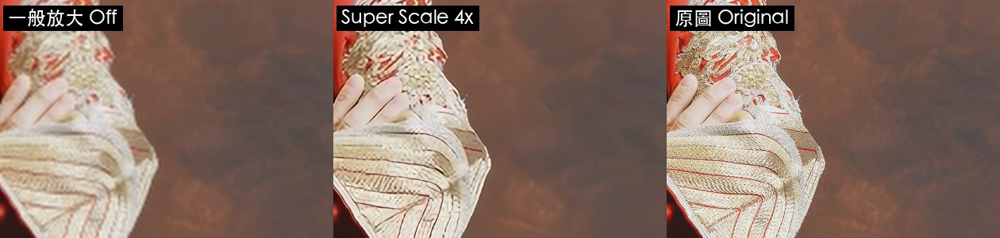
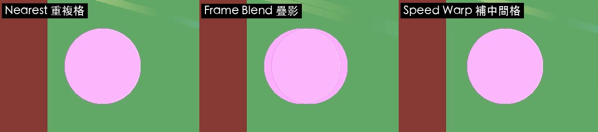
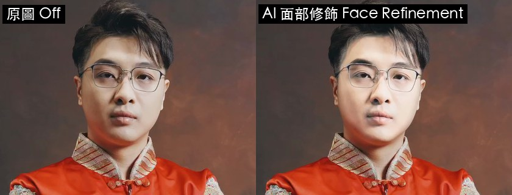
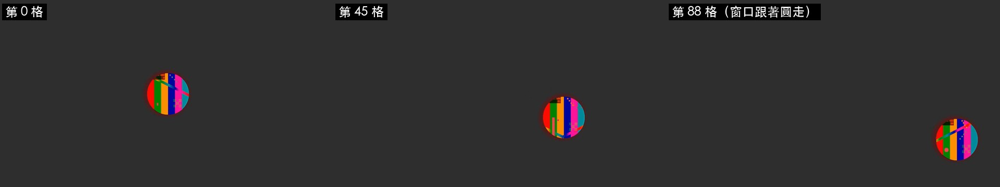

# 第 21 章　Studio 版限定功能實測：AI 放大、補幀、人聲分離、面部修飾、HDR、3D

> 英文版：[docs/en/21-studio-ai.md](../en/21-studio-ai.md)
> 範例：[examples/21_studio_ai.py](../../examples/21_studio_ai.py)、[examples/21b_hdr_stereo.py](../../examples/21b_hdr_stereo.py)，以及要先在畫面上操作的 [21c](../../examples/21c_fairlight_check.py)／[21d](../../examples/21d_face_check.py)／[21e](../../examples/21e_window_track_check.py)

驗證環境：macOS 27.0.1／Resolve Studio 21.1.0.14／Apple M2 Max 32GB／2026-10-20。

Blackmagic 官網的 Studio 版賣點（AI 追蹤、Resolve FX、Fairlight FX、HDR、立體 3D）逐項實測。每一項都輸出成檔案，跟參考檔比對數字，不是只看 API 有沒有回 True。

| 功能 | 用程式能不能做 | 結果 |
|---|---|---|
| Super Scale（AI 放大） | 能 | 4x、2x 增強版有效；3x 對照片幾乎沒差 |
| Speed Warp（AI 補幀慢動作） | 能 | 沒有疊影，畫質優於一般慢動作 |
| Voice Isolation（人聲分離） | 能 | 雜訊 -36 → -70 dB，人聲不變 |
| Dialogue Leveler（對白音量平衡） | 能 | 屬性能開，但它不是降噪 |
| Fairlight FX（降噪、殘響等） | 不能，要用滑鼠拖 | 降噪 -8 dB、殘響有尾音 |
| AI 面部修飾 Face Refinement | 不能，要用滑鼠點 | 只改臉、衣服不變 |
| HDR 輸出（Rec.2100 PQ） | 能 | 輸出 10-bit HEVC，標記 BT.2020／PQ |
| 立體 3D | 能（建立、輸出） | 預設輸出左眼 |
| Power Window 追蹤 | 不能，要用滑鼠點 | 追蹤誤差 1 px 以內 |

### 21.1 Super Scale：AI 放大低解析素材

- 結論：Super Scale 是 MediaPoolItem 的片段屬性，用 `SetClipProperty("Super Scale", n)` 設定（1＝關、2／3／4＝倍數）。「2x 增強版」要用四個參數 `SetClipProperty("Super Scale", 2, 銳利度, 降噪)`，兩個值都是 0～1。
- 驗證：實測通過——把 1278×720 的照片縮成 426×240 放上 1920×1080 時間軸，輸出後跟原圖比 SSIM（越接近 1 越像原圖）：
  - 關閉：0.761
  - 2x 增強（0.5, 0.5）：0.788
  - 4x（在設過 2x 增強之後）：0.793
  - 3x：0.756（比關閉還低一點）
  - 合成測試圖（色條、線條）：關閉 0.730、4x 0.770
- **地雷：銳利度和降噪會「黏」在片段上。** 設過一次 2x 增強後，再設普通的 2x，輸出跟 2x 增強逐格一樣；4x 在設過 2x 增強前後的輸出也不同。要確定參數，就每次都用四參數的寫法。讀回來的 `SuperScale Sharpness`／`Noise Reduction` 也不可靠（沒設過時也回 0.5）。
- 做法：

```python
item = media_pool_item                       # 不是 TimelineItem
item.SetClipProperty("Super Scale", 2, 0.5, 0.5)   # 2x 增強
item.SetClipProperty("Super Scale", 4)             # 4x（沿用上面的銳利度／降噪）
item.SetClipProperty("Super Scale", 1)             # 關閉
```

- 確認：輸出後跟高解析原圖比 SSIM，或放大同一塊看邊緣。
- 人類補充：適合小時候的舊照片、截圖這類小圖。原本就夠大的照片不會變更好。



### 21.2 Speed Warp：AI 補幀慢動作

- 結論：`TimelineItem.SetProperties({"RetimeProcess": r.RETIME_OPTICAL_FLOW, "MotionEstimation": r.MOTION_EST_SPEED_WARP_BETTER})`，再用 `SetSpeed` 放慢。
- **地雷：放慢時要加 `RippleTimeline: True`。** 不加的話片段長度不變，30 格的片段設 25% 後還是 30 格，只播來源的前 7 格。加了才會變成 120 格。
- 驗證：實測通過——一個圓每格移動 16 px，放慢到 25%，跟「原生 120 fps 拍的同一個畫面」比 PSNR（越高越像）：
  - Nearest（重複格）：28.76 dB
  - Frame Blend（疊影）：29.87 dB
  - Optical Flow Enhanced Better：30.90 dB
  - Speed Warp Better：30.71 dB
  - 中間格放大看：Frame Blend 有兩個半透明的圓，Speed Warp 只有一個、位置在中間。
- 注意：這個測試畫面很單純，Speed Warp 跟 Enhanced Better 差不多。Speed Warp 是為人物、複雜動作設計的，真實素材的差別可能比較大（未測）。
- 做法：

```python
item.SetSpeed({"Percentage": 25.0, "RippleTimeline": True})
item.SetProperties({"RetimeProcess": r.RETIME_OPTICAL_FLOW,
                    "MotionEstimation": r.MOTION_EST_SPEED_WARP_BETTER})
```



### 21.3 Voice Isolation 與 Dialogue Leveler

- 結論：21.1 新增的音訊屬性。`AudioVoiceIsolationEnabled`／`AudioVoiceIsolationAmount`（0～100），只對**目前作用中的時間軸**有效（先 `SetCurrentTimeline`）。也可以用 `TimelineItem.EnableVoiceIsolationState({"isEnabled": True, "amount": 100})`，或整軌 `Timeline.SetVoiceIsolationState(軌道, {...})`。
- 驗證：實測通過——用 macOS `say`（美佳）唸三句國語，疊上很大聲的粉紅雜訊，句子之間留 1.5 秒空白：
  - 關閉：空白處雜訊 -35.9 dB、說話處 -17.7 dB
  - Voice Isolation 100：空白處 **-69.5 dB**、說話處 -17.9 dB（人聲幾乎沒變）
  - Dialogue Leveler：空白處 -34.4 dB、說話處 -18.5 dB——它是把對白音量拉平，不是降噪，空白處還變大聲一點
- 做法：

```python
project.SetCurrentTimeline(tl)
audio_item.SetProperties({"AudioVoiceIsolationEnabled": True, "AudioVoiceIsolationAmount": 100})
audio_item.GetVoiceIsolationState()   # {'isEnabled': True, 'amount': 100}
```

- 人類補充：婚禮致詞、現場訪談、戶外錄音最有用。強度 100 在這個測試沒有傷到人聲，但真實錄音建議從 50～70 開始聽。

### 21.4 Fairlight FX：沒有 API，要用滑鼠拖

- 結論：降噪、殘響、等化、De-Esser 等 Fairlight FX 沒有任何 API 能加到片段上（`GetFairlightPresets()` 只列出使用者存的預設，沒存過就是空的）。要在剪輯頁「特效庫 → 音頻特效 → Fairlight FX」把效果拖到音訊片段上，用 CGEvent（1.11）可以自動完成。加上後，輸出照常生效。
- 驗證：實測通過（[examples/21c_fairlight_check.py](../../examples/21c_fairlight_check.py)，先用 `--setup` 建時間軸，拖完效果再跑一次）：
  - Noise Reduction（自動語音模式）：空白處雜訊 -35.9 → -44.3 dB（少 8.4 dB）
  - Reverb（預設，殘響時間 950 ms）：說完話後 0.3 秒內，從 -69.4 → -22.2 dB，有明顯尾音
- 比較：同一段聲音，Voice Isolation 壓掉 33.6 dB，Noise Reduction 預設只有 8.4 dB。要去雜訊，優先用 21.3 的 Voice Isolation（而且有 API）。
- 操作重點（簡體中文介面）：
  1. 特效庫面板左側點「音频特效 → Fairlight FX」，或用右上放大鏡搜尋英文名（Noise、Reverb）
  2. 拖到時間軸的音訊片段上，片段名稱前出現 fx 圖示、並跳出外掛視窗
  3. 降噪預設是「手動」，要點「自动语音模式」才會自己抓雜訊
- **地雷：搜尋框打字只進第一個字。** 點放大鏡後用 `keystroke` 打字，只會出現第一個字母；要再點一次輸入框，才能把剩下的字打進去。中文用剪貼簿貼上也沒有反應，改搜英文名。
- 量法：用 `Timeline.SetTrackEnable("audio", n, False)` 關掉其他軌，一軌一軌輸出來量。

### 21.5 AI 面部修飾（Face Refinement）：只在調色頁

- 結論：Face Refinement 只能在調色頁的節點上用，Fusion 的 `GetRegList` 裡沒有它（同類的 `Beauty`、`BlemishRemoval`、`SoftSharpenSkin` 有）。沒有 API 能按「偵測人臉」和「追蹤」，要用滑鼠點。
- 驗證：實測通過（[examples/21d_face_check.py](../../examples/21d_face_check.py)，作者本人照片）：
  - 只開皮膚紋理（磨皮）程度 1.0：已經修過圖的婚紗照幾乎看不出來（臉部跟原圖 PSNR 42.6 dB），衣服完全不變
  - 再把皮膚調色的「中間調」拉到 1.0：臉部亮度 148.8 → 187.1，衣服 99.2 → 99.2
- 操作重點：
  1. 調色頁右上「特效庫」搜尋 Face，把「面部修饰」拖到節點上
  2. 右側設定按「检测画面中的人脸」，畫面上出現綠框
  3. 按雙向追蹤（⇄），完成後才會整段都有效
  4. 調參數：數值框雙擊 → `Cmd+A` → 打數字 → Return
- 21 版同一類還有「Face Age Transformer」（臉部年齡）和「面部重塑器」，未測。



### 21.6 HDR 輸出：專案設定全部能用程式改

- 結論：色彩管理跟輸出色彩空間都是專案設定，用 `SetSetting` 改。輸出選 `mov`＋`H265`、`EncodingProfile: "Main10"`，再把 `ColorSpaceTag`／`GammaTag` 設成 `"Same as Project"`，檔案就會帶 HDR 標記。
- 驗證：實測通過（[examples/21b_hdr_stereo.py](../../examples/21b_hdr_stereo.py)）——
  - ffprobe：`hevc Main 10`、`yuv420p10le`、`bt2020nc`、`smpte2084`、`bt2020`
  - 同一塊中灰（SDR 約 19 nits）：SDR 輸出 10-bit 值 515，PQ 輸出 362。換算約 0.34 的 PQ 訊號，跟 19 nits 的理論值相符
- **地雷：`rcmPresetMode: "HDR"` 回傳 True，但輸出色彩空間還是 Rec.709。** 要把 `isAutoColorManage` 設成 `"0"`，自己指定時間軸與輸出色彩空間。
- 一定要開**另一個專案**做 HDR：色彩管理改了會影響整個專案所有時間軸。
- 做法：

```python
for k, v in {"colorScienceMode": "davinciYRGBColorManagedv2", "isAutoColorManage": "0",
             "colorSpaceInput": "Rec.709 Gamma 2.4", "colorSpaceTimeline": "DaVinci WG/Intermediate",
             "colorSpaceOutput": "Rec.2100 ST2084", "timelineWorkingLuminanceMode": "HDR 1000",
             "hdrMasteringOn": "1", "hdrMasteringLuminanceMax": "1000"}.items():
    project.SetSetting(k, v)
project.SetCurrentRenderFormatAndCodec("mov", "H265")
project.SetRenderSettings({"EncodingProfile": "Main10", "ColorSpaceTag": "Same as Project",
                           "GammaTag": "Same as Project"})
```

- 人類補充：HDR 影片要在支援 HDR 的螢幕或手機上看才有效果。一般 SDR 素材轉 HDR 不會自己變漂亮，亮部要另外調。

### 21.7 立體 3D

- 結論：`MediaPool.CreateStereoClip(左眼, 右眼)` 會把兩個片段合成一個 3D 片段，放上時間軸可以正常輸出。
- 驗證：實測通過——左右眼畫面差 24 px。3D 片段輸出跟左眼完全一樣（PSNR inf），跟右眼 19.2 dB，也就是**預設只輸出左眼**。`GetStereoConvergenceValues()` 回 `{0: 0.0}`。
- **地雷：`CreateStereoClip` 會把兩個輸入片段「換掉」。** 左眼的媒體池項目會變成 3D 片段，原本的單眼片段就不見了。要再用單眼畫面，先複製一份檔案另外匯入。重跑腳本前也要先刪掉舊的。
- 未測：左右並排、紅藍眼鏡的輸出格式要在交付頁選，`SetRenderSettings` 沒有對應的欄位。

### 21.8 Power Window 追蹤

- 結論：畫窗口、按追蹤沒有 API，要用滑鼠點（1.11）。窗口所在節點的調色可以用 `SetCDL` 設，只會作用在窗口裡面，而且跟著追蹤結果移動。
- 驗證：實測通過（[examples/21e_window_track_check.py](../../examples/21e_window_track_check.py)）——一個圓在灰底上每格往右 8 px、往下 3 px，共 90 格：
  - 追蹤器結果：平移 711.73、豎移 -268.31；實際是 712、267（往下是負的）
  - `SetCDL` 把節點調紅：第 0、45、88 格圓上的紅色都增加 50～80，第 88 格圓原本所在的位置是中性灰（R-G＝0）
- 操作重點：
  1. 調色頁下方工具列點窗口圖示，再點「圆形」新增圓形窗口（預設在畫面中央）
  2. 右邊「变换 → 大小」輸入數字調整大小（本例 23，剛好包住直徑 240 px 的圓）
  3. 點追蹤器圖示，按 ▶（往後追蹤）
- 背景越單純越好追。窗口裡如果有不動的背景紋理，會把追蹤往回拉。



### 21.9 這次新增的操作地雷

- **Resolve 視窗比螢幕還寬。** 本機的 Resolve 視窗是 3440 px 寬，在 1920 的螢幕上右半邊（節點、特效庫按鈕）看不到。先用 System Events 調整視窗大小：

```bash
osascript -e 'tell application "System Events" to tell process "Resolve" to set size of window 1 to {1920, 1050}'
```

- 腳本裡呼叫 `render()` 後會切回剪輯頁，接著要點調色頁的東西，先 `OpenPage("color")`。
- 遠端桌面（DeskIn）連線時，右下角的浮動面板會蓋住畫面，找座標時要避開。
